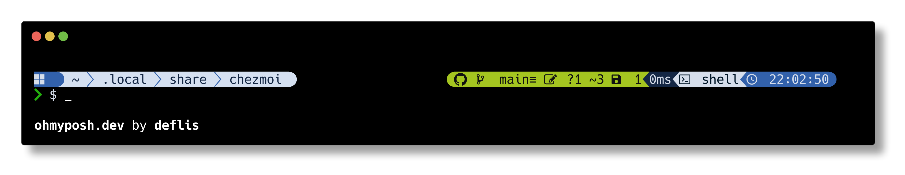

# dotfiles

[chezmoi](https://www.chezmoi.io/) ベースにしていちからやり直します。



<!-- `oh-my-posh config export image  --rprompt-offset 20 --author deflis` -->

## 自動インストールできないもの

- フォント
  - [Hasklig](https://github.com/i-tu/Hasklig)
  - [HackGen](https://github.com/yuru7/HackGen)
- Windows Terminal の設定

### linuxbrew でインストールした zsh を有効にする

```shell
which zsh | sudo tee -a /etc/shells
chsh -s `which zsh`
```

## なんとかしたいやつ

- [Windows Terminal のデフォルト設定を指定したい](./private_dot_config/windows_terminal/settings.json)

## パッケージのcooldown

新しく公開されたバージョンは、個人用マシンでは1日、仕事用マシンでは3日待ってから解決する。
`.chezmoi.toml.tmpl` の `isWork` で切り替え、日数は `.chezmoitemplates/release-age-days` に集約している。

| ツール | 設定 | 単位・形式 | グローバル設定の配置先 |
| --- | --- | --- | --- |
| npm / npx | `min-release-age` | 日 | `~/.npmrc` |
| pnpm | `minimumReleaseAge` | 分 | `~/.config/pnpm/config.yaml`、macOS標準の `~/Library/Preferences/pnpm/config.yaml`、Windows標準の `%LOCALAPPDATA%/pnpm/config/config.yaml` |
| Bun / bunx | `install.minimumReleaseAge` | `1d` / `3d`（Bun 1.4.4以降） | `~/.bunfig.toml` と `~/.config/.bunfig.toml` |
| Yarn（現行版） | `npmMinimalAgeGate` | `1d` / `3d` | `~/.yarnrc.yml` |
| mise | `settings.minimum_release_age` | `1d` / `3d` | `~/.config/mise/conf.d/settings.toml` |

pnpmはcooldownを `.npmrc` から設定せず、グローバルの `config.yaml` を使う。
`XDG_CONFIG_HOME` が設定されている場合、pnpmとBunはその配下を参照する。
このリポジトリのzsh設定では `~/.config` を使うため、OS標準のパスと両方に同じ内容を配置する。
独自の `XDG_CONFIG_HOME` やWindowsの独自の `LOCALAPPDATA` を使う場合は、配置先も合わせること。

miseのClaude Codeも共通のcooldownに従う。miseのnpmバックエンドは既存の組み込みaubeを使い、
cooldownはmiseから渡される。mise自体の `self-update` も共通の待機期間を継承する。

cooldownはバージョンの新規解決に対する既定値であり、プロジェクト設定やCLI引数で上書きできる。
既存のlockfileを再検査する仕組みではなく、miseの完全指定バージョンや `mise.lock` は対象外。
リリース日時を取得できないmiseバックエンドでは待機を保証できない。

設定仕様: [npm](https://docs.npmjs.com/cli/using-npm/config/#min-release-age)、
[pnpm](https://pnpm.io/configuring#global-configuration)、
[Bun](https://bun.com/docs/runtime/bunfig#installminimumreleaseage)、
[Yarn](https://yarnpkg.com/configuration/yarnrc#npmMinimalAgeGate)、
[mise](https://mise.jdx.dev/configuration/settings.html#minimum_release_age)。
